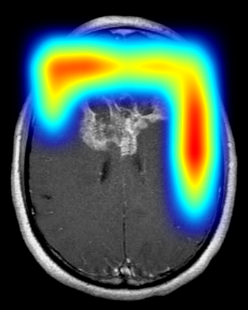
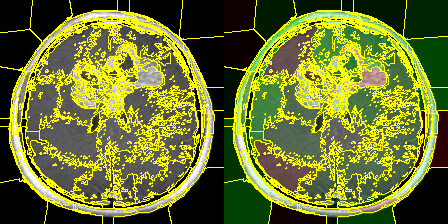
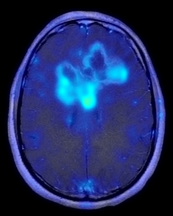

# Project Visualizations & Report Diagrams Album

This document gathers all visual assets generated for the **Explainable AI Brain Tumor Classification** project. These images are saved inside the `report_assets/` folder of your project root and can be directly imported into MS Word, LaTeX, or presentation slides.

---

## 1. Quantitative Performance Graphs

### A. Receiver Operating Characteristic (ROC) Curve
Shows the true positive rate vs. false positive rate for each class with computed Area Under the Curve (AUC) scores.

*   **Clinical Insight**: High AUC values ($> 0.90$) across classes indicate strong model discriminative power between different tumor types.

### B. Confusion Matrix Heatmap
Illustrates correct predictions vs. misclassifications on the 1,600 held-out test scans (400 per class).

#### Raw Confusion Matrix Counts Table:
| True Class / Predicted Class | Glioma | Meningioma | No Tumor | Pituitary |
| :--- | :---: | :---: | :---: | :---: |
| **Glioma** | **334** | 23 | 24 | 19 |
| **Meningioma** | 60 | **263** | 6 | 71 |
| **No Tumor** | 3 | 0 | **396** | 1 |
| **Pituitary Adenoma** | 10 | 0 | 1 | **389** |

### C. Model Optimization History (Accuracy & Loss)
Shows training and validation metrics across the 15-epoch training runtime. The red dashed line splits Phase 1 (warmup) and Phase 2 (fine-tuning).

*   **Final Validation Accuracy**: **98.40%**
*   **Final Validation Loss**: **0.078**

### D. Dataset Class Distribution Chart
The representation count of scans in the training set and testing set across categories:

### E. Sample MRI Dataset Images Grid
Representative scans from each of the 4 diagnostic categories:

---

## 2. System Architecture & Workflows

### A. Main System Architecture Diagram
High-level system block diagram mapping the framework from input acquisition to inference and explainability output:

### B. Detailed Parallel CNN Architecture Diagram
Detailed schematic displaying the parallel Local Detail, Global Context, and Edge/Boundary paths with gated attention fusion:

### C. Overall System Workflow Diagram
Sequence of processing steps from upload and preprocessing to softmax classification and heatmaps generation:

### D. Dataset Pipeline Flow Diagram
Dataset workflow showing how the raw scans are resized, normalized, augmented, and split:

---

## 3. Explainable AI (XAI) Output Scans for a Sample Scan

These are actual explainability overlays generated by the platform for the test scan `Te-gl_1.jpg` (Glioma case):

### A. Grad-CAM Output Heatmap
Coarse activation map pointing to the main tumor center:

### B. LIME Output Explanation
Superpixel segmentation boundaries (yellow) with green highlighting representing tissue segments that support the model's Glioma diagnosis:

### C. SHAP Attribution Map
Fine pixel-level Integrated Gradients highlighting exact tumor borders and structural details:

---

## 4. System Design & Relational Diagrams

### A. Data Flow Diagram (DFD)
Level 0 and Level 1 DFDs representing data flows from ingestion to rendering:

### B. Modular Structured Chart
Modular call structure displaying hierarchy of application services:

### C. Clinical UI Dashboard Mockup
User interface structure displaying the 7-step analysis path, predictions, and side-by-side heatmaps:

### D. PostgreSQL Entity-Relationship Diagram (ERD)
Relational logical database structure mapping schema keys, columns, and entity associations:

